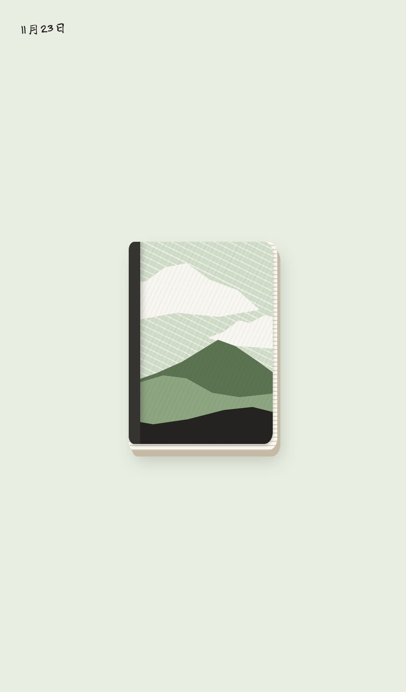
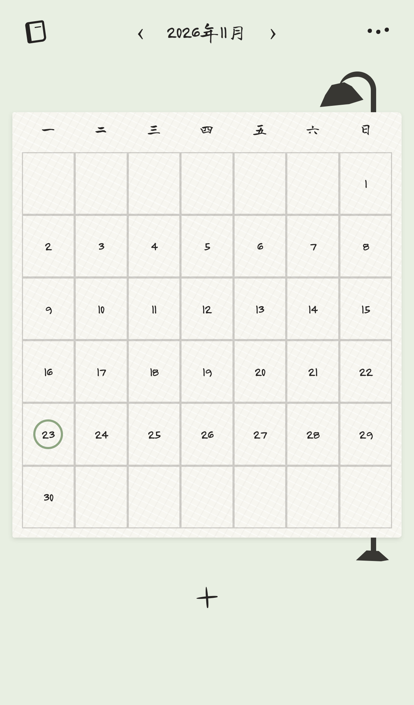

# ei ？

一本随手贴照片、画两笔，就能留下生活片段的小日记本。

面向iPhone的手写涂鸦日记PWA，无需登录。同一天可以记很多页，没记录的日子就留白。

**[立即体验](https://ei-diary-check.pages.dev/) · [自行部署](#自行部署) · [数据与备份](docs/data-and-backup.md) · [本地开发](#本地开发)**

当前准备版本为 **v0.1.0**，正式发布及本轮更新验收尚未完成。体验站可能晚于仓库代码更新。[更新与回退](docs/updating.md) · [版本记录](CHANGELOG.md)。GitHub仓库：[jiangcan04/ei-diary](https://github.com/jiangcan04/ei-diary)。

## 看看本子

以下截图在独立空白浏览器中生成，无真实个人日记。

| 封面 | 月历 |
|---|---|
|  |  |

## 记下一件小事

1. 点封面翻开本子，再点月历下方「＋」记一页。补记时直接选过去的日期。
2. 手指写画，或点照片工具贴入多张照片；调整位置和大小，再点画笔写画。
3. 工具栏直接选择颜色、粗细和整笔橡皮，照片操作与笔迹共用撤销。
4. 点保存，看到「已保存」后可继续写；返回也会先等待保存，失败时留在原页供重试。
5. 从月历作品进入阅读，点或拖纸角连续翻页，同一天的其他页可通过页签选择。

默认记录日于设备本地凌晨02:00切换；凌晨00:00至01:59的新页仍归前一天。可以手动修改过去日期。空白新页不保存为记录。

## 数据放在哪里

日记、照片及笔迹保存在当前设备、当前网站的浏览器存储中。网站托管提供应用文件，不替你云备份日记。同网址在iPhone和iPad上也各自保存，不自动同步。请定期[导出并验证备份](docs/data-and-backup.md)。

首次联网完成加载后可离线使用。浏览器清除数据、设备丢失等可能导致本地记录丢失；离线缓存不是日记备份。当前没有登录、应用锁和云同步。iPad可打开，Apple Pencil与具体机型手感需实际验证，尚不宣称完整iPad专项适配。

在Safari打开HTTPS网址，使用分享菜单中的「添加到主屏幕」。安装后从图标启动；不同系统的入口文字以实际显示为准。

## 自行部署

当前可用方式：本地构建后，将dist目录上传至HTTPS静态网站托管平台，部署在站点根路径。不要上传源码目录作为构建产物。

按[Cloudflare Pages的Git连接部署教程](docs/deploy-cloudflare.md)部署。目前已从作者仓库验证独立Pages站的主屏幕启动、离线保存及备份恢复；其他账号Fork流程尚未实测，目前未提供一键部署按钮。部署到自己的网址不会自动提供服务器数据存储或跨设备同步。

换网址前先导出备份，在新网址恢复并验证内容后再停用旧网址。普通版本更新保持原网址。

## 本地开发

需要Node.js **26.10.0**，与.nvmrc一致。在包含package.json的项目目录执行：

```bash
npm ci
npm run dev
```

打开终端显示的本地网址。开发服务不是长期部署方式，也不能通过双击index.html替代。

验证及生产构建：

```bash
npm run typecheck
npm test
npm run build
npx playwright install webkit
npm run test:e2e
```

先构建再运行端到端测试。生产预览使用npm run preview。正式部署上传dist；手机离线PWA验收使用HTTPS。干净环境验证见[开发验收说明](docs/clean-environment-check.md)。

## 许可

项目代码及作者确认原创的图标、封面和界面装饰采用[MIT](LICENSE)。Long Cang字体保留独立OFL许可，依赖遵循各自许可，详见[第三方说明](docs/third-party-notices.md)及[字体核查记录](docs/font-audit.md)。
